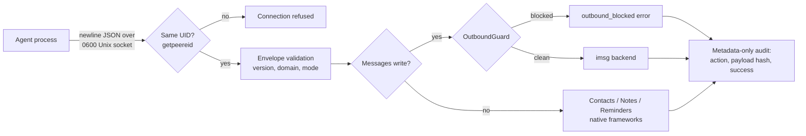

# Agent Apple Bridge

[](https://github.com/migelizaga-rgb/agent-apple-bridge/actions/workflows/ci.yml)

A macOS Swift service that gives local AI agents structured access to Contacts,
Messages, Notes, and Reminders through a Unix socket. It keeps native privacy
permissions and outbound content checks in one service, with no network listener
or third-party Swift dependencies.

## Features

- Contacts search and lookup, read-only.
- Notes accounts, folders, search, full bodies, and create/update/move/delete.
- Reminders lists, search, create/update/complete/move/delete, and change markers.
- Messages reads and guarded sends through an external `imsg` executable;
  other message and group actions depend on the backend's capabilities.
- Versioned JSON requests, pagination, structured errors, and metadata-only audits.

## Security model

The service is disabled by default. `AGENT_BRIDGE_ENABLED=1` enables startup.
Release builds require a valid signature with the package's bundle identifier
and either an Apple-anchored signing identity or an explicitly pinned leaf
certificate. A debug-only unsigned bypass exists for isolated tests; release
builds ignore it. The bundle namespace is encoded with character escapes in
source and decoded normally by Swift and the plist reader.

The socket is mode `0600`; its containing directory must be owned by the service
user and deny all group/other permissions (normally `0700`). New directories are
created as `0700`. Each connection must have the same effective UID, checked with
`getpeereid`. Use a dedicated private directory for a custom socket. This is a
same-user trust boundary: any process running as that user can call the bridge.
It does not authenticate individual agents or isolate their permissions.

Every non-preview Messages write passes through `OutboundGuard` before backend
execution. The guard rejects generic credential patterns, raw tool-call JSON,
private system paths, and sensitive configuration strings, including nested
content. Attachments require explicit colon-separated allowed roots; the default
is empty and denies every attachment. Paths are canonicalized with symlinks
resolved, files must be regular and at most 10 MiB, and extensions are restricted
to `pdf`, `docx`, `xlsx`, `txt`, `csv`, `md`, `json`, `png`, `jpg`, `jpeg`, `gif`,
and `webp`. UTF-8 text attachments are also scanned for blocked content.
There are no built-in recipient, handle, or chat allowlists. OutboundGuard is a
content check, not recipient authorization. **Sends require the caller's approval
layer**, which must obtain human approval for the exact action, recipients, and
content before submitting a write. Apply approval to other mutations as well.
`dryRun` only previews a Messages write; it neither authorizes delivery nor
certifies that the content would pass the guard.

Redaction is implemented by rejecting suspect outbound content, not silently
rewriting it. Audit rows retain timestamp, domain, mode, action, success, and a
SHA-256 payload hash; they omit raw parameters, recipient data, and message
bodies. Audit files are created as `0600`; protect configured audit paths and
existing files yourself. Reads return personal data as requested without
redaction. Pattern checks are heuristic; binary documents/images are not scanned
for embedded secrets. Attachment paths can change between checking and backend
opening: allow only directories that trusted processes can modify.

macOS TCC permission is still required: Contacts access, full Reminders access,
and Automation access to Notes. Messages generally needs Full Disk Access for
history and Automation access for sending; some backend actions also need
Accessibility or additional backend support. Grant only permissions needed for
your use in System Settings → Privacy & Security. Stable signing and an app
bundle keep permission identity consistent. The bridge never grants TCC access
or bypasses system restrictions. Tests use capability requests and a fake
Messages backend and need no real TCC grants.

## How a request flows



What the guard does, captured from a debug build whose Messages backend was
replaced with `/usr/bin/false` so nothing could be sent:

```text
> Running 5 min late
< {"success":false,"code":"command_failed","error":"Apple bridge command exited 1","version":1}
> Deploy key is ghp_aaaaaaaaaaaaaaaaaaaaaa…
< {"success":false,"code":"outbound_blocked","error":"message content failed the GitHub token pre-send check","version":1}
> See /Users/example/notes.txt
< {"success":false,"code":"outbound_blocked","error":"message content failed the internal path pre-send check","version":1}
> {"path":"/etc/hosts"}
< {"success":false,"code":"outbound_blocked","error":"message content failed the raw tool-call JSON pre-send check","version":1}
```

The clean message passed the guard and reached the (inert) backend. The other
three never did. The audit log records each attempt without its content:

```json
{"action":"send","domain":"messages","mode":"write","payloadHash":"fd17203b…","success":false,"ts":"2026-11-26T03:44:52Z"}
```

## Install

Requires macOS 14+, Swift 6+, and Node.js 24+ for the example and integration
tests. Messages additionally requires a compatible `imsg` installation providing
`status --json`, read subcommands with JSON output, and `send --json`. Set its
absolute executable path; it defaults to `/opt/homebrew/bin/imsg`.

```sh
swift build
swift test
# Create a release app bundle. Supply an existing signing identity for real use.
export AGENT_BRIDGE_SIGNING_IDENTITY='Developer ID Application: YOUR IDENTITY'
./scripts/build-app.sh
AGENT_BRIDGE_ENABLED=1 dist/AgentAppleBridge.app/Contents/MacOS/AgentAppleBridge
```

The build script does not install a persistent service or obtain a signing
identity. Without a signing identity it produces an unsigned app which the
release startup gate will reject. For a locally issued certificate, configure
its 40-character SHA-1 leaf hash in `AGENT_BRIDGE_PINNED_LEAF` both while signing
and when starting the app; the script adds the matching designated requirement.
Keep the app at a stable location when granting permissions.

## Configuration

| Variable | Default / purpose |
| --- | --- |
| `AGENT_BRIDGE_ENABLED` | Disabled; accepts `1`, `true`, `yes`, or `on` |
| `AGENT_BRIDGE_SOCKET` | `~/Library/Application Support/AgentAppleBridge/apple-bridge.sock` |
| `AGENT_BRIDGE_AUDIT_PATH` | `~/Library/Logs/AgentAppleBridge/apple-bridge-audit.jsonl` |
| `AGENT_BRIDGE_STATE_DIR` | `~/Library/Application Support/AgentAppleBridge` for Reminders change markers |
| `AGENT_BRIDGE_ALLOWED_ROOTS` | Empty; colon-separated absolute attachment directories |
| `AGENT_BRIDGE_IMSG_PATH` | `/opt/homebrew/bin/imsg`; trusted Messages executable |
| `AGENT_BRIDGE_PINNED_LEAF` | Empty; optional signing certificate leaf hash |
| `AGENT_BRIDGE_SIGNING_IDENTITY` | Empty; build script's existing signing identity |
| `AGENT_BRIDGE_ALLOW_UNSIGNED_TEST` | Debug builds only: `1` bypasses signing for tests |

Environment paths must be expanded absolute paths; the service does not expand
`~`. Treat service configuration and the backend executable as trusted input.

## Usage example

With the service running, read Notes capabilities without prompting for access:

```sh
node examples/client.js
```

The client sends one newline-terminated request and receives one JSON response:

```json
{"version":1,"domain":"notes","mode":"read","params":{"action":"capabilities"}}
```

For an actual Notes read, use `action: "list"` with `limit: 10` and
`includeBody: false`. Request envelopes use `version: 1`, a domain from
`contacts`, `messages`, `notes`, `reminders`, a `read` or `write` mode, and an
object `params`. Success responses contain `success: true` and `result`;
failures contain `success: false`, `code`, and `error`. Inspect each handler's
capabilities for supported actions (Contacts supports `search` and `get`).

## Testing

```sh
swift build
swift test
node Tests/bridge-contract.js
node Tests/bridge-e2e.js
```

XCTest covers request validation, outbound checks, empty attachment defaults, attachment size/type/UTF-8 and symlink restrictions,
Contacts write refusal, and the decoded bundle namespace. Ported Node tests
check component contracts, debug/release signing gates, real socket framing and
permissions, pagination, error mapping, stubbed sends, attachment checks, and
audit privacy. They never deliver a real message. CI runs these checks on macOS. The socket integration test requires an environment
that permits local Unix socket binding; it fails explicitly if binding is denied.

## Limitations

The server handles connections serially, caps requests at 8 MiB, and uses a
10-second per-read socket timeout. A slow same-user client can still delay other
clients. Backend processes have bounded runtime and output. Notes uses macOS
JavaScript automation; locked notes and attachment content may be unavailable.
Messages pagination is bounded to the first 200 backend rows. Advanced Messages
actions depend on backend and OS support. Real TCC prompts, signing enrollment,
and live application reads/writes require separate manual validation. Audit
writes are best-effort and are not a tamper-proof approval ledger.

MIT licensed; see [LICENSE](LICENSE).
